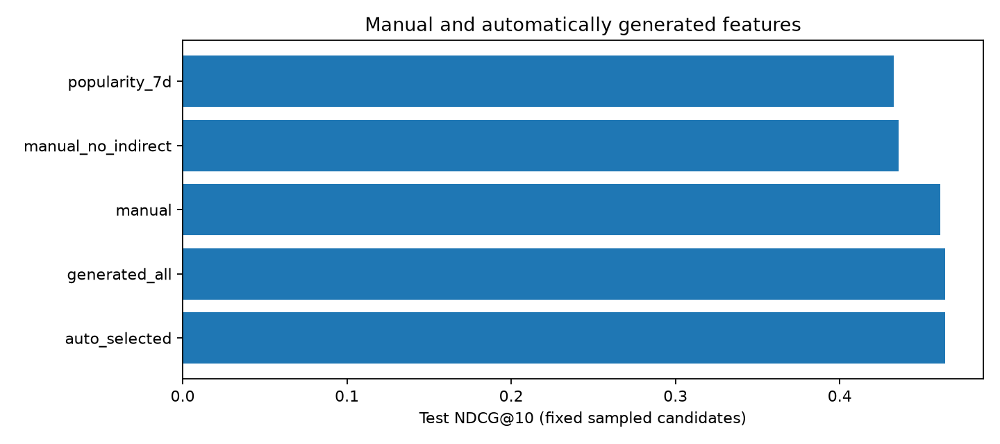

# Разбор CatBoost и автоматического поиска окон

Основной CPU-эксперимент использует 50 000 случайных пользователей, 285 343
события с сохранением полной доступной истории, четыре train snapshot и
непересекающиеся validation/test недели. Итоговая test-оценка — 1480 запросов
из 1500 выбранных пользователей; полностью холодные группы исключены и
перечислены в protocol.json. Результат условный: все известные позитивы
добавлены в фиксированный набор с синтетическими негативами.

## Ручные признаки дают содержательную прибавку

Средний test NDCG@10 ручного baseline по seeds 42/43/44 — 0,46107;
семидневная популярность даёт 0,43307. В сопоставимой абляции seed 42
исключение user–genre и user–director снижает NDCG на 0,02305.
Косвенные связи оказываются полезнее прямого повторного потребления.

Суммарная CatBoost-важность прямых user–item признаков равна нулю. Это
согласуется с источником: повторных строк пары нет, а просмотренные объекты
не входят в кандидаты. Считать эту группу «сильной персонализацией» здесь
было бы ошибкой. Метаданные и связанные с ними прошлые предпочтения дают
реальный полезный сигнал без придумывания повторных событий.

## Автоматизация немного улучшает point estimate

Validation выбрал все восемь дополнительных окон. Число признаков выросло
с 74 до 186. Средний test NDCG — 0,46417 против 0,46107 у ручного baseline,
разница +0,00310 (около +0,67% относительно baseline). Recall меняется мало:
0,60152 против 0,60046.

Если сначала усреднить парную метрику каждого пользователя по трём seed,
а затем bootstrap-ить пользователей, 95%-й CI разницы NDCG получается
[-0,00054; 0,00646]. Во всех трёх seed point estimate положителен, но уверенного
общего выигрыша на этом окне не установлено. Отдельные CI и число пользователей
сохранены; усреднение метрик seed не называется ensemble-ranking.

Поиск по окнам вычислительно доступен: общий feature builder на шести snapshot
занял около 8,92 s, сумма времён всех поисковых CatBoost fits — 306,90 s,
весь основной запуск — 330,25 s. Peak RSS процесса — около 4,67 GiB.
Ручной builder отдельно не таймировался: обе ветки использовали общую матрицу,
поэтому нельзя выдавать эти числа за точное end-to-end ускорение относительно
ручной ветки.

## LLM-поиск выражений

Её эксперимент выполнен отдельно, но использует те же сохранённые признаки,
кандидаты, даты и правила ранжирования. Сравниваются ручной baseline, random
search и локальная LLM с одинаковым целевым бюджетом принятых кандидатов.
Невалидные и повторные предложения учитываются, baseline разрешён как fallback.
Основной интерфейс — infix->RPN, Qwen2.5-Coder-1.5B-Instruct, seed 42:

| Метод | Принято / попыток | Validation NDCG@10 | Test NDCG@10 | Test Recall@10 |
| --- | --- | --- | --- | --- |
| Manual | — | 0.46857 | 0.45886 | 0.60055 |
| Random search | 12 / 12 | 0.47126 | 0.46132 | 0.59962 |
| LLM search | 12 / 45 | 0.47230 | 0.45976 | 0.59861 |

LLM выигрывает у manual +0,00090 NDCG, CI [-0,00358; 0,00514]. Разница LLM
минус random равна -0,00155, CI [-0,00518; 0,00230]. Все интервалы пересекают
ноль. На validation LLM выглядит лучше random, но на test точечный порядок
обратный. Это согласуется с нестабильным выбором на одном holdout; уверенного
преимущества LLM не установлено. Здесь сравнивается один и тот же seed 42,
а не LLM против усреднённого по трём seed manual.

Выбранный LLM-признак: `i_recency * i_rate_w90 - i_watch_w7`.
Random выбрал `(ug_watch_w90 - i_watch_w7) * (i_recency + u_count_w90)`.
Это преобразования уже доступных сигналов; их выражения нельзя интерпретировать
как причинные зависимости или физически осмысленные величины.

Формат стал отдельным ограничением. Strict-RPN версия дала 0 валидных
предложений из 48 как на CPU, так и на Tesla T4 и вернулась к baseline.
Infix-интерфейс поднял число принятых до 12 из 45; 33 ответа отклонены из-за
синтаксиса, незавершённой генерации, неподдерживаемых имён/операций или более
пяти операций. Невалидные ответы не заменялись искусственными признаками.
Переход к infix был выбран по ошибкам формата до финального test этой ветки.

CPU infix run занял 1934,46 с; суммарное время попыток random 368,68 с,
LLM 1378,94 с. Это время включает генерацию и обучение кандидатов; полный
run также содержит baseline, загрузку модели и fits комбинаций. Часть запуска
пересекалась с продолжившим работу старым RPN worker, поэтому это измеренный
расход времени в доступном окружении, а не чистый benchmark оборудования.
Расходы заметно выше поиска окон при отсутствии убедительного выигрыша качества.

В отдельном GPU-повторении infix LLM получила NDCG 0,46405, выше CPU point
estimate. Её CI против manual положителен, но против random пересекает ноль.
Различающиеся proposal sets на CPU/GPU подчёркивают нестабильность; лучший
test между устройствами не выбирался. Подробности в [GPU-анализе](GPU_ANALYSIS.md).

Replay по сохранённым CPU-ответам без загрузки Qwen занял 665,32 с и точно
повторил все решения по 45 предложениям, validation selection, итоговые метрики
и per-query оценки. Это проверка воспроизводимости, а не новый независимый
LLM-эксперимент. Проверка — `artifacts/promptfe_replay_identity.json`.

После обнаружения общего каталога вывода двух worker артефакты восстановлены
раздельно по журналам и prompt syntax. Все итоговые saved models заново
предсказали test, их метрики совпали с CSV; подробности в протоколах artifacts/ и
`artifacts/final_audit.json`. Разбор не опирается на смешанные промежуточные файлы.

В эксперименте используются исторические агрегаты, временной holdout,
CatBoost/NDCG, локальная Qwen 1.5B и 12 принятых предложений.
Сравниваются top-1/top-3/top-5 выражений и ручной baseline как fallback.
Текущий вычислитель реализован локально; точное повторение журналов
использует сохранённые random expressions и LLM responses.

## Почему прибавка может быть небольшой

Ручной baseline уже содержит несколько масштабов времени, recency, отношения
и косвенные связи. Дополнительные окна сильно коррелируют с существующими.
Арифметические преобразования признаков перераспределяют существующую
информацию; сами по себе они не добавляют новых взаимодействий из прошлого.
Для ideal axis-aligned деревьев монотонные преобразования одного признака
сохраняют порядок возможных разбиений; практический эффект может возникать
через quantization, регуляризацию, early stopping и явные взаимодействия
нескольких признаков. Поэтому нельзя заранее ожидать крупного выигрыша
от `log(count)` поверх сильного бустинга.

Сэмпл пользователей остаётся намного меньше полной базы. Один validation
период и множество проверенных вариантов создают риск выбора случайного
локального выигрыша. В этом эксперименте test не использовался для выбора
окон, но устойчивость ко временным сдвигам одним test-окном не доказана.
Первый жанр/режиссёр также упрощают многозначные метаданные; построенный
baseline содержателен, но не объявляется оптимальным промышленным решением.
