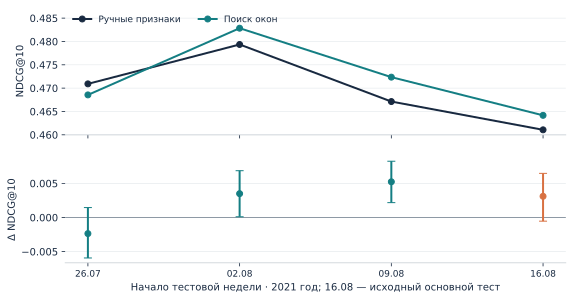

# Дополнительная временная проверка

Этот анализ добавлен после знакомства с исходным test. Грамматика, hyperparameters, выбор пользователей и правила кандидатов сохранены; в каждой новой неделе модель обучается заново на прошлом и выбирает признаки только на своём validation. Исходный основной результат не заменяется.

| test_cutoff | manual_ndcg | auto_ndcg | mean | ci95 | features | role |
| --- | --- | --- | --- | --- | --- | --- |
| 2021-07-26 | 0.47091 | 0.46855 | -0.00236 | [-0.0059378655800925734, 0.001448623831520975] | 130 | exploratory |
| 2021-08-02 | 0.47935 | 0.48284 | 0.00349 | [0.00010716729578219978, 0.006857416138383228] | 88 | exploratory |
| 2021-08-09 | 0.46712 | 0.47235 | 0.00523 | [0.0021786133977898187, 0.00824546158367442] | 102 | exploratory |
| 2021-08-16 | 0.46107 | 0.46417 | 0.00310 | [-0.0005389835116096346, 0.006463697330698203] | 186 | original primary |

Пользователи и train-периоды перекрываются. Абсолютный NDCG между неделями зависит от состава событий и кандидатов; корректное сравнение методов — внутри каждой недели. Процедура поиска окон обязательно выбирает хотя бы один дополнительный блок: manual fallback здесь отсутствует, в отличие от LLM-поиск. Это ограничение дизайна, а не гарантия выигрыша на validation или test.

Команда: `python -m task1.temporal_study`. Настройки и границы времени: `artifacts/task1_temporal/study_protocol.json`, `test_*/time_boundaries.json`.
