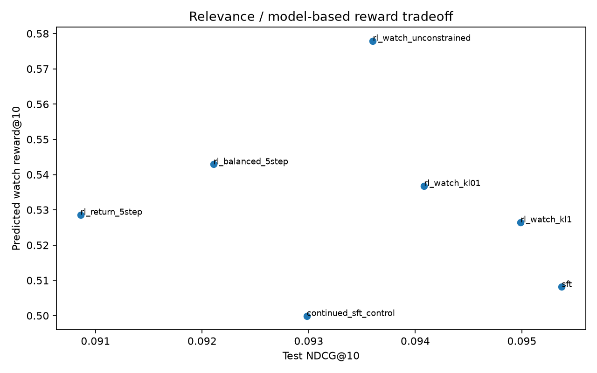

# Разбор основного CPU-эксперимента

На 50 000 случайных пользователей сохранены все 285 343 события. SFT/RM используют
100 000 train-примеров; validation и test — по 2000 пользователей. В словаре 8029
train-объектов. 8,25% test-targets холодные: они остаются в знаменателе и дают
промах. Основной результат фиксируется для CPU seed 42; GPU-повторение служит
проверкой протокола, а не способом выбрать более выгодную test-таблицу.

## Оптимизация reward работает, улучшение рекомендаций не установлено

У SFT test NDCG@10 = 0,09537 и Recall@10 = 0,1645. Без ограничений RL повышает
средний predicted watch@10 с 0,50813 до 0,57794 (+13,74%), но NDCG снижается до
0,09360. При KL=1 предсказанный reward растёт умереннее, до 0,52648, а NDCG
остаётся ближе к SFT: 0,09499. Более сильное удержание около reference policy
ограничивает как изменение reward, так и изменение релевантности.

По заранее определённому validation-критерию выбран balanced five-step вариант.
На test он даёт reward 0,54293 (+6,85% относительно SFT), NDCG 0,09211
(-3,43%) и Recall 0,1575. Парная разница NDCG = -0,00327, 95%-й bootstrap CI
[-0,00684; 0,00023]. Интервал пересекает ноль: точечное ухудшение есть, но
уверенного утверждения о снижении качества на всей популяции этот эксперимент
не поддерживает. Тем более он не подтверждает улучшения реального отклика.

Полные значения всех вариантов находятся в [таблицах](RESULTS.md). Награды в
training logs разных reward-функций имеют разный смысл; сравнивать их абсолютные
значения напрямую нельзя. В итоговой таблице для всех политик показан один и тот
же watch-proxy от замороженной RM.

## Reward model достаточно для оптимизации, но слаба как модель мира

На test основная RM имеет MAE 0,33567, RMSE 0,37870 и R² 0,0122. Сглаженное
train-среднее объекта даёт MAE 0,34490 и RMSE 0,38337; глобальное среднее —
MAE 0,36762 и RMSE 0,39681. Улучшение MAE относительно item mean составляет
0,00924, paired bootstrap CI [0,00539; 0,01326]. При этом RM объясняет лишь
малую долю дисперсии watch fraction: предсказания нельзя считать надёжным
симулятором всех пользовательских реакций.

Auditor с другой инициализацией имеет R² около -0,080. Это полезный сигнал
нестабильности модели, но не независимая ground truth. Обе сети обучены на одних
и тех же наблюдаемых взаимодействиях и могут разделять систематические ошибки.
Точное совпадение их оценок тоже не доказало бы причинного эффекта.

Оптимизация не ушла в объекты вообще без train-reward поддержки: у рекомендаций
unconstrained RL медианная поддержка 1377 train-примеров против 835 у SFT,
нулевой поддержки нет. Поэтому объяснение «модель просто нашла совершенно
необученный item» эти данные не подтверждают. Наблюдаемая проблема ближе к
концентрации на хорошо известных RM объектах и к несовпадению reward-proxy
с задачей next-item relevance. Проверяемые per-user предсказания сохранены в
`artifacts/task2/reward_test_predictions.csv`.

## Контроль дополнительных supervised шагов

Continued-SFT/KL контроль использует те же CE=.2, KL=.1, learning rate, train
батчи и 200 обновлений, что one-step constrained RL, при нулевом коэффициенте
policy gradient. Он даёт NDCG 0,09298 и predicted watch 0,49991.

One-step RL KL=.1 даёт NDCG 0,09408: разница относительно контроля +0,00110,
95%-й CI [-0,00259; 0,00459]. Reward выше на 0,03687. Таким образом, RL меняет
поведение сверх простого продолжения CE, но уверенного выигрыша релевантности
над этим контролем не установлено. Контроль был предусмотрен до получения
основных test-метрик и не участвовал в исходном выборе среди пяти RL-вариантов.

## Концентрация и гипотетические пять шагов

После unconstrained RL хотя бы один конкретный объект попадает в top-10 уже
98,95% test-пользователей; у SFT — 84,15%. Это прямой признак усиления
концентрации, даже если сумма предсказанных вознаграждений выросла.

Ещё более заметен top-1: один и тот же объект становится первым у 88,0%
пользователей вместо 23,4% у SFT. Покрытие каталога top-10 падает с 5,39%
до 2,52%, entropy показов — с 3,94 до 3,20 nat. Рост среднего watch-proxy
сопровождается сужением множества рекомендаций. При этом доля фильмов
растёт с 62,52% до 68,61%; это сдвиг типа контента, но без независимой длительности
объектов его нельзя трактовать как доказанное предпочтение коротких фильмов.

Greedy rollout повторяет ранее сгенерированный item на пятом шаге в 95,70%
контекстов SFT и 98,83% unconstrained RL. У balanced policy — 93,36%.
У balanced повторов точечно меньше, но относительно unconstrained вместе
меняются штраф, KL/CE и горизонт: эффект одного штрафа здесь не изолирован.
Жёсткого ограничения повторов в этих вариантах нет.
На пятом шаге unconstrained policy использует всего 6 различных item среди
256 пользователей против 19 у SFT. Проблема проявляется уже у исходной
авторегрессионной модели и усиливается под неограниченной reward-оптимизацией.

Вероятные причины: короткие реальные истории (медиана KION — два объекта),
teacher-forced train-контексты, отличающиеся от сгенерированных, и отсутствие
жёсткой маски уже рекомендованных объектов. Это объяснения, согласующиеся с
наблюдениями; отдельной причинной абляции tied embeddings или attention нет.
Объект, добавленный в rollout-контекст, не означает его реального потребления.
Оценки с frozen context и generated context — диагностические модельные числа,
а не наблюдаемые многошаговые возвраты пользователей.

## Зависимость от длины реальной истории

| Число объектов в контексте | Пользователи | SFT NDCG@10 | Balanced NDCG@10 |
| --- | --- | --- | --- |
| 1 | 363 | 0.14279 | 0.14671 |
| 2–5 | 632 | 0.11795 | 0.11307 |
| 6–15 | 552 | 0.08241 | 0.07436 |
| 16+ | 453 | 0.04168 | 0.04073 |

Средняя метрика скрывает различия групп: у самых коротких контекстов point
estimate balanced даже выше, у остальных ниже. Более длинная история здесь
не означает более простую задачу: активные пользователи могут смотреть более
разнообразный контент. Это описательная стратификация без поправки на различия
каталогов и поведения; она не доказывает, что удлинение контекста причинно
снижает качество. Все модели оценены на одинаковых пользователях каждой группы.

## Что говорит трёхдневный proxy

Return-head имеет test AUC 0,5655 и Brier 0,25044. Константа train prevalence
даёт Brier 0,25064. Train prevalence около 0,503, а на полностью наблюдаемых
test-окнах — около 0,402. У модели есть небольшой ranking signal, но точность
такого proxy недостаточна для уверенного вывода об удержании.

Return-ориентированный RL повышает predicted return@10 с 0,44249 до 0,44915,
при NDCG 0,09086 против 0,09537 у SFT. Покрытие 5,80% немного выше исходных
5,39%, но выигрыш одного model-based proxy не компенсирует отсутствие
наблюдаемого долгосрочного эффекта и снижение point estimate релевантности.

Кроме того, KION хранит агрегированные пары с `last_watch_dt`, а не полные
сессии и посещения приложения. Следующий активный день в выпущенной таблице
не равен наблюдаемому возвращению в сервис после конкретной рекомендации.
Неполные follow-up окна цензурируются; это устраняет одну техническую ошибку,
но не решает проблему идентификации долгосрочного эффекта.
Упорядочивание объектов по ID внутри прошлых дней также лишь техническое:
исходный внутридневной порядок неизвестен. Таким образом, next-item модель
проверяется на дневном proxy, а не на точном потоке отдельных просмотров.

## Ограничения и следующий эксперимент

Один исходный seed, один test-период и условный logging distribution не позволяют
делать широкие промышленные выводы. GPU-повторение использует те же примеры и
исходники, но не является дополнительным независимым набором пользователей.
Статические метаданные не имеют исторических снимков; полной истории показов,
известных propensities и независимого intrinsic duration объекта нет. Поэтому
мы не заявляем unbiased off-policy estimates или доказанное предпочтение
коротких фильмов. Сдвиги film/series и жанров сохранены отдельно.

Следующий шаг — event-level логи (например, Yambda), несколько временных окон
и seed, лучше откалиброванная RM, контроль поддержки распределения и response-
conditioned переходы: не добавлять объект в историю без смоделированного отклика.
Для настоящего retention-вывода нужен онлайн A/B с достаточно длинным follow-up:
активные дни/возврат через неделю и удовлетворённость, при guardrails на
релевантность, повторы и концентрацию. Офлайн рост predicted reward таким
экспериментом не заменяется.
