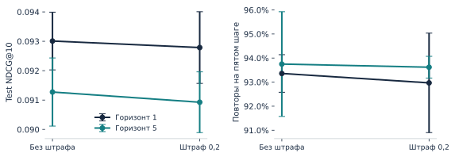
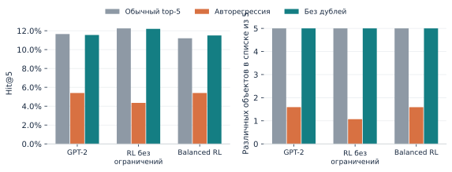

# Дополнительные проверки RL и генерации

Протоколы зафиксированы до новых запусков, но после просмотра основного test. Это исследовательская диагностика; все клетки публикуются, новая primary model не выбирается.

## Горизонт × штраф

KL=.1, CE=.2, 200 обновлений, 3 согласованных RL seed (42/43/44), неизменные SFT/RM. Для seed 42 обе исходные клетки точно повторили прежние метрики. Seeds меняют minibatches и sampling, а не полное обучение системы.

| horizon | penalty | ndcg@10 mean | ndcg@10 std | predicted_watch@10 mean | predicted_watch@10 std | history_repeat@10 mean | history_repeat@10 std |
| --- | --- | --- | --- | --- | --- | --- | --- |
| 1 | 0.00000 | 0.09301 | 0.00098 | 0.54025 | 0.00303 | 0.16583 | 0.00053 |
| 1 | 0.20000 | 0.09279 | 0.00122 | 0.54002 | 0.00227 | 0.16353 | 0.00068 |
| 5 | 0.00000 | 0.09127 | 0.00116 | 0.54682 | 0.00339 | 0.16577 | 0.00079 |
| 5 | 0.20000 | 0.09093 | 0.00103 | 0.54622 | 0.00335 | 0.16258 | 0.00118 |

| effect | mean | ci95 | users |
| --- | --- | --- | --- |
| repeat_penalty_h1 | -0.00022 | [-0.001090367350656421, 0.000630311614328931] | 2000 |
| repeat_penalty_h5 | -0.00035 | [-0.0014096966507128762, 0.0007316681817332473] | 2000 |
| horizon_penalty0.0 | -0.00174 | [-0.003031842697380486, -0.00048101487477812015] | 2000 |
| horizon_penalty0.2 | -0.00186 | [-0.0032003364500631576, -0.00042945066686012105] | 2000 |
| interaction | -0.00013 | [-0.0011414740646797387, 0.0009082788531699543] | 2000 |

При фиксированных настройках увеличение горизонта уменьшает NDCG; изолированный эффект repeat penalty мал и CI пересекает ноль. Bootstrap усредняет метрику каждого пользователя по трём RL seeds, затем ресэмплирует пользователей. Равны обновления, а не число действий: 12 800 для H=1 против 64 000 для H=5. Масштаб return также меняется. Это не универсальное утверждение о длинных горизонтах.

## Декодирование пяти объектов

| policy | mode | hit@5 | ndcg@5 | mean_unique_items | max_item_user_fraction |
| --- | --- | --- | --- | --- | --- |
| sft | one_shot | 0.11650 | 0.07998 | 5.00000 | 0.70950 |
| sft | autoregressive | 0.05400 | 0.04909 | 1.59100 | 0.38700 |
| sft | no_repeat | 0.11550 | 0.07963 | 5.00000 | 0.76900 |
| rl_watch_unconstrained | one_shot | 0.12250 | 0.07997 | 5.00000 | 0.98400 |
| rl_watch_unconstrained | autoregressive | 0.04350 | 0.04170 | 1.06900 | 0.93750 |
| rl_watch_unconstrained | no_repeat | 0.12200 | 0.07858 | 5.00000 | 0.99250 |
| rl_balanced_5step | one_shot | 0.11200 | 0.07732 | 5.00000 | 0.71350 |
| rl_balanced_5step | autoregressive | 0.05400 | 0.04846 | 1.58850 | 0.36250 |
| rl_balanced_5step | no_repeat | 0.11500 | 0.07867 | 5.00000 | 0.67800 |

В обычном top-5 контекст не меняется. При авторегрессии предполагается потребление сгенерированного объекта; no-repeat лишь исключает уже выданные ID. Исторические объекты дополнительно не маскируются. Релевантность учитывает первое появление единственного next target, дубликаты не дают повторного gain. Эти slate@5 метрики не заменяют исходный full-catalog@10.

SFT Hit@5: .1165 / .0540 / .1155 для one-shot / autoregressive / no-repeat. Запрет дублей восстанавливает большую часть потери. Но у unconstrained RL один item остаётся в 99.25% уникальных списков; устранение дублей не устраняет концентрацию между пользователями. Это офлайн-диагностика и не доказательство retention-эффекта.

Команды: `python -m task2.factorial`, `python -m task2.decoding_study`. Согласованные парные CI и все per-user результаты находятся в соответствующих `artifacts/`.
